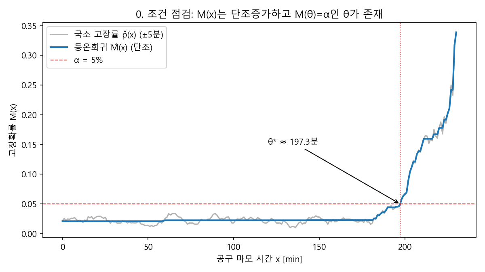

# AI4I 2020 × Robbins–Monro 확률근사

Robbins–Monro(1951) *A Stochastic Approximation Method* 의 정리를 공장 예지보전 데이터(AI4I 2020)에 적용한 해석학 탐구입니다.
고장 기록(0/1)만으로 **"고장확률이 5%가 되는 공구 마모 시간"**을 추정하고, 논문의 수렴 조건을 하나씩 깨뜨려 각 조건의 역할을 실험으로 확인했습니다.

| 핵심 결과 | |
| --- | --- |
| 추정한 공구 교체 시점 θ (α = 5%) | **약 197분** (30,000스텝, 197.2 ± 0.5분) |
| Σa_n² = ∞ (상수 걸음) | 오차가 RMSE 4.9분에서 정체 |
| Σa_n < ∞ (1/n² 걸음) | 127분에서 멈춤, θ 도달 실패 |
| 단조성 위반 (토크) | 출발점에 따라 성공률 0% / 98% / 79% |
| 같은 예산(3,000회) 비교 | RMSE: 로빈스–먼로 3.2 · 격자+등온회귀 6.7 · 로지스틱 44.4 |



## 폴더 구조

```
.
├── 초기제공자료/          처음 제공된 자료 (데이터, 주제 선정 안내)
│   ├── ai4i2020.csv
│   └── 해석학 주제정하기.png
├── src/
│   ├── rm_core.py         오라클, 등온회귀(PAV), Robbins–Monro 본체
│   └── experiments.py     실험 0, A, A′, B, C, C′, D, E, F, 식 (15) 점검
├── results/               실험 그림 8장 + summary.txt (모든 수치)
└── reports/
    ├── 01_실험설계보고서.md   실험 전 설계: 기술적 필요성, 사용할 논문 개념, 실험 목록
    └── 02_결과보고서.md       팀 공유용 결과 설명 (증명 해설, 실험별 결과, Q&A)
```

## 실행

```
pip install -r requirements.txt
python src/experiments.py
```

난수 시드가 고정되어 있어 `results/summary.txt` 와 같은 값이 다시 나옵니다(약 1–2분).

## 자료 출처

- **논문**: H. Robbins, S. Monro, "A Stochastic Approximation Method," *Annals of Mathematical Statistics* 22(3), 1951, pp. 400–407. 저작권 문제로 PDF는 저장소에 포함하지 않았습니다. JSTOR 또는 Project Euclid에서 열람하세요.
- **데이터**: S. Matzka, "AI4I 2020 Predictive Maintenance Dataset," UCI Machine Learning Repository, 2020 (CC BY 4.0).
