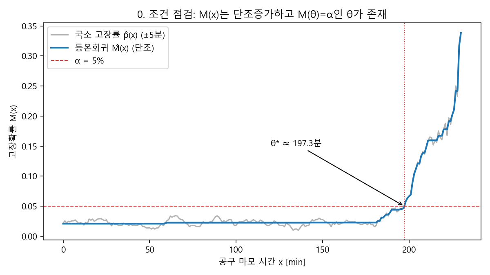
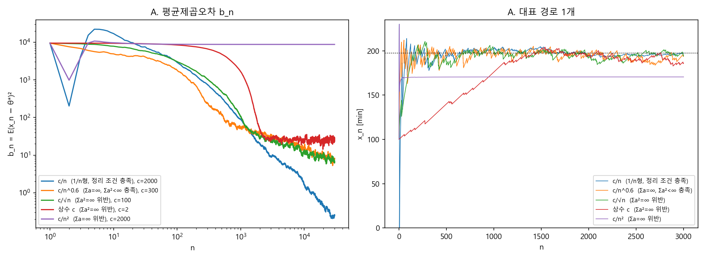
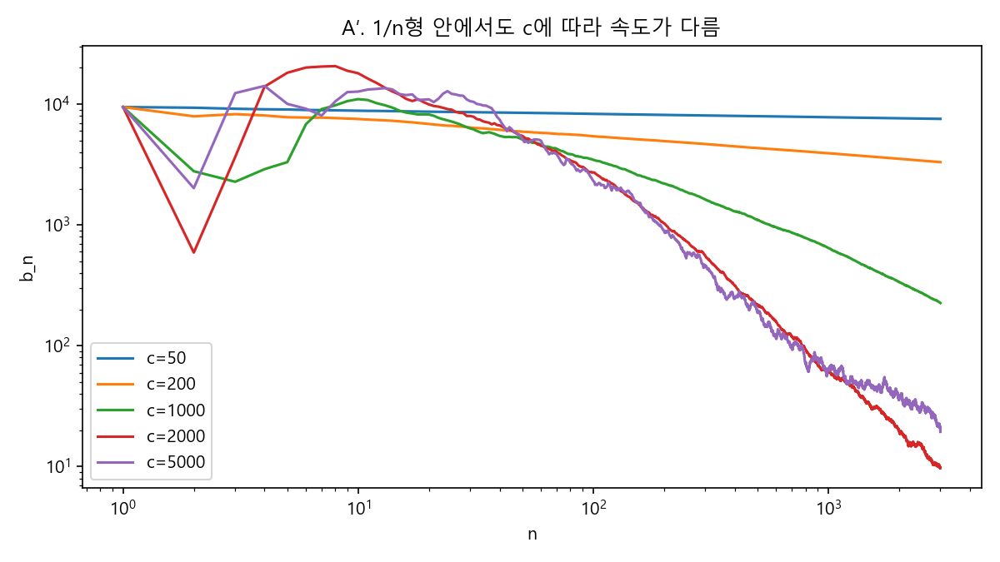
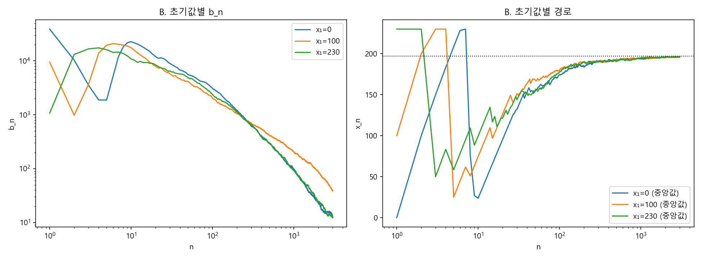
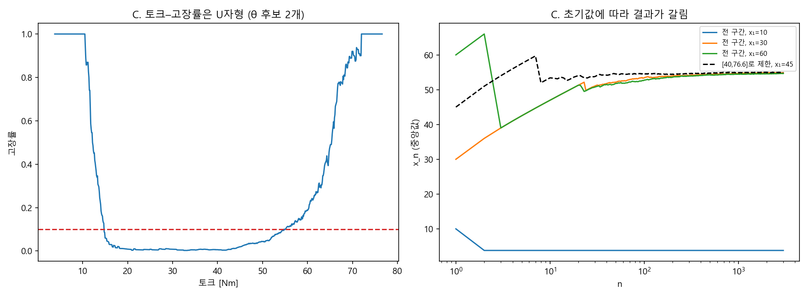
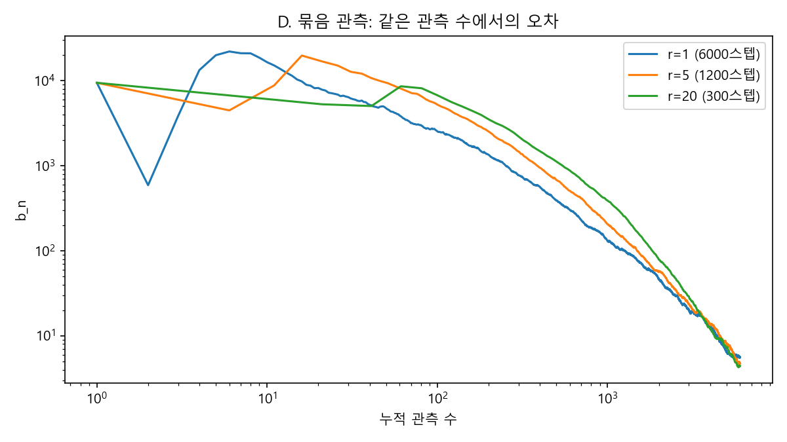
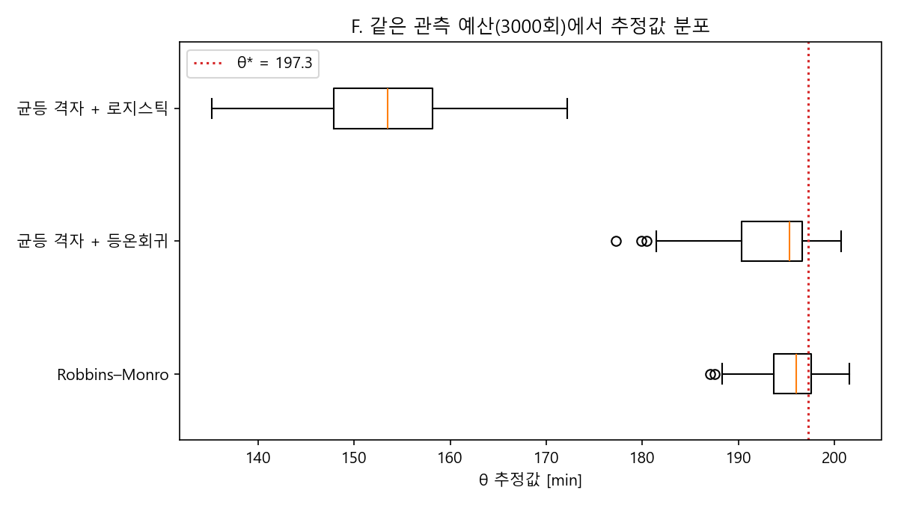
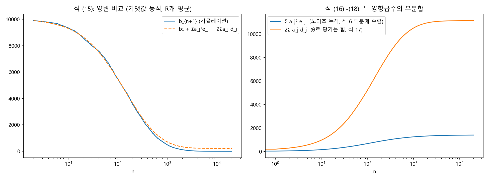

# 로빈스–먼로 탐구 결과보고서 (팀 공유용)

> 설계는 [01_실험설계보고서.md](01_실험설계보고서.md), 코드는 [`src/`](../src), 원본 수치는 [`results/summary.txt`](../results/summary.txt)에 있습니다.

## 1. 한눈에 보기

**한 줄 결론: 고장 기록(0/1)만 가지고도 "고장확률이 5%가 되는 공구 마모 시간"을 약 197분으로 찾아냈고, 논문이 말한 조건을 깨면 실제로 실패한다는 것까지 확인했다.**

이 문서는 제출용이 아니라 팀원들이 내용을 이해하기 위한 설명서다. 수식이 나오면 바로 아래에 "쉽게 말하면"을 붙였다.

| 질문 | 답 |
| --- | --- |
| 무엇을 했나? | Robbins–Monro(1951) 논문의 "확률근사법"을 공장 장비 데이터(AI4I 2020)에 적용해 봤다. |
| 무엇을 찾았나? | 고장확률 5%가 되는 공구 마모 시간 θ ≈ **197분** (10%는 약 203분) |
| 얼마나 정확한가? | 30,000번 반복하면 평균 197.2분, 흔들림 ±0.5분 |
| 논문 조건은 정말 필요한가? | 걸음 크기를 1/n²로 하면 127분에서 멈추고, 상수로 하면 오차가 더 안 줄고, 단조가 아닌 변수(토크)에선 출발점에 따라 결과가 달라졌다. |
| 다른 방법보다 나은가? | 같은 3,000번 관측에서 오차(RMSE): 로빈스–먼로 3.2분, 골고루 조사 6.7분, 로지스틱 회귀 44.4분 |
| 해석학과의 연결은? | 급수의 수렴·발산(Σa_n²<∞, Σa_n=∞), 단조함수, 중간값정리, 미분의 정의, inf, ε-논법이 증명의 뼈대다. |

발표의 핵심 문장은 이것 하나다.

> **Σa_n = ∞ 는 "목표까지 도달"을, Σa_n² < ∞ 는 "도착한 뒤 안정"을, 단조성은 "올바른 방향"을 보장한다.**

## 2. 우리가 푼 문제를 쉽게

공장 기계의 공구(날)는 쓸수록 닳고, 닳을수록 기계가 고장 날 확률이 올라간다. 너무 일찍 갈면 공구가 아깝고, 너무 늦게 갈면 기계가 멈춘다. 그래서 현장은 **"고장확률이 5%가 되기 직전에 갈자"** 같은 규칙을 원한다. 그 시점이 바로 θ(세타)다.

### 문제가 어려운 이유 3가지

1. **공식을 모른다.** "마모 x분이면 고장확률은 몇 %"라는 함수 M(x)를 아무도 알려주지 않는다.
2. **관측이 거칠다.** 한 번 돌려보면 "고장남(1)" 또는 "괜찮음(0)" 하나만 나온다. 확률이 5%인지 20%인지는 한 번 봐서는 절대 모른다.
3. **실험이 비싸다.** 고장 날 때까지 돌려보는 건 돈과 시간이 든다. 모든 x에서 수백 번씩 시험할 수는 없다.

### 비유: 눈 가리고 샤워 온도 맞추기

눈을 가린 채 샤워 손잡이를 돌려 "딱 좋은 온도"를 찾는다고 하자. 물은 줄기마다 온도가 조금씩 다르게 느껴진다(노이즈).

- 차갑다 → 손잡이를 뜨겁게 쪽으로 조금 돌린다.
- 뜨겁다 → 차갑게 쪽으로 조금 돌린다.
- **처음엔 크게, 갈수록 작게** 돌린다. 안 그러면 좋은 온도 근처에서 계속 오락가락한다.

로빈스–먼로 알고리즘이 정확히 이것이다. 논문은 "얼마나 빨리 줄여야 결국 정확히 맞는가"를 수학적으로 증명했다.

### 우리 문제에 대입하면

| 기호 | 뜻 | 우리 문제에서 |
| --- | --- | --- |
| x | 우리가 고르는 값 (다이얼) | 공구 마모 시간 [분] |
| y | 관측 결과 | 고장 1 / 정상 0 |
| M(x) | y의 평균 (모르는 함수) | 마모 x분일 때 고장확률 |
| α (알파) | 맞추고 싶은 목표값 | 0.05 (허용 고장확률 5%) |
| θ (세타) | M(θ) = α 인 점 (우리가 찾는 답) | 권장 공구 교체 시점 |
| a_n | n번째 걸음 크기 | 다이얼을 얼마나 돌릴지 |

논문 4절은 바로 이런 "반응(1)/무반응(0)" 데이터를 다룬다. 원래 예시는 약물 실험(얼마나 투여하면 절반이 반응하나)이고, 우리는 그걸 공구 고장에 그대로 가져왔다.

## 3. 로빈스–먼로 알고리즘 쉽게 이해하기

알고리즘은 식 하나가 전부다(논문 식 7, 45).

$$x_{n+1} = x_n + a_n(\alpha - y_n)$$

**쉽게 말하면**: "다음에 시험할 마모 시간 = 지금 마모 시간 + 걸음 크기 × (목표 − 이번 결과)"

- 이번에 **고장 안 남**(y=0): α − 0 = +0.05 → x를 **조금 올린다**. (아직 안전하니 더 써봐도 되겠다)
- 이번에 **고장 남**(y=1): α − 1 = −0.95 → x를 **크게 내린다**. (위험하니 더 일찍 갈자)
- 걸음 크기 a_n은 횟수가 지날수록 작아진다. 우리는 a_n = 2000/n을 썼다.

### 왜 θ에서 멈추나: 줄다리기 균형

n = 1000일 때 a_n = 2다. x가 정확히 θ에 있다고 하자. 그러면 고장확률이 딱 5%다.

| 경우 | 확률 | x의 변화 | 확률 × 변화 |
| --- | --- | --- | --- |
| 고장 안 남 (y=0) | 0.95 | 2 × (+0.05) = +0.1분 | +0.095 |
| 고장 남 (y=1) | 0.05 | 2 × (−0.95) = −1.9분 | −0.095 |
| **평균 이동** | | | **0** |

θ에서는 **평균 이동이 0**이라 제자리에 머문다. θ보다 왼쪽(고장확률 < 5%)이면 오른쪽으로, 오른쪽이면 왼쪽으로 당겨진다. 이것이 "x_n이 θ로 모인다"의 직관이다. 식으로 쓰면 평균 이동은 a_n(α − M(x_n))이고, M(θ) = α 이므로 θ에서 0이다.

### 손으로 따라가 보기 (초반 3번)

x₁ = 100분에서 시작, a_n = 2000/n, α = 0.05.

| n | x_n | a_n | 결과 y_n | 계산 | x_{n+1} |
| --- | --- | --- | --- | --- | --- |
| 1 | 100 | 2000 | 0 | 100 + 2000×0.05 | 200 |
| 2 | 200 | 1000 | 0 | 200 + 1000×0.05 = 250 → 상한 230으로 자름 | 230 |
| 3 | 230 | 666.7 | 1 | 230 − 666.7×0.95 = −403 → 하한 0으로 자름 | 0 |

초반에는 걸음이 커서 양 끝을 오간다. 그래서 코드는 x를 항상 [0, 230] 안으로 자른다(**사영**, projection). 걸음이 작아지면 위의 줄다리기 균형이 작동해 θ 근처로 모인다.

### 걸음 크기에 대한 두 조건 (가장 중요)

$$\sum_{n=1}^{\infty} a_n = \infty \qquad\text{and}\qquad \sum_{n=1}^{\infty} a_n^2 < \infty$$

| 조건 | 쉽게 말하면 | 없으면? | a_n = 1/n은? |
| --- | --- | --- | --- |
| Σa_n = ∞ | 걸음을 다 합치면 무한히 갈 수 있다 → 출발점이 아무리 멀어도 θ까지 간다 | 중간에 기름이 떨어져 멈춤 | 조화급수 1 + 1/2 + 1/3 + … = ∞ ✔ |
| Σa_n² < ∞ | 노이즈가 누적되는 양이 유한하다 → 도착한 뒤 흔들림이 사라진다 | θ 주변에서 영원히 흔들림 | 1 + 1/4 + 1/9 + … = π²/6 ✔ |

1/n은 두 조건을 동시에 만족하는 "딱 좋은" 속도로 줄어든다. 논문은 이런 수열을 **1/n형(type 1/n)**이라고 부른다. c′/n ≤ a_n ≤ c″/n이면 모두 여기에 든다(식 30).

## 4. 왜 수렴하나: 정리 2의 증명 따라가기

증명의 전략은 "오차를 하나의 수열 b_n으로 만들고, 그 수열이 0으로 간다는 것을 급수로 보이는 것"이다. 자세한 계산은 논문 401–405쪽에 있고, 여기서는 각 단계가 **무슨 말을 하는지**만 정리한다.

### 정리 2 (무엇을 보장하나)

다음 세 가지가 맞으면, **출발점 x₁이 어디든** b_n = E(x_n − θ)² → 0 이다.

1. 걸음 크기 a_n이 1/n형이다 (Σa_n² < ∞ 이고 충분히 느리게 줄어든다).
2. 관측값이 유계다: |y| ≤ C (식 4). 우리는 y가 0 아니면 1이라 C = 1로 자동 성립.
3. M(x)가 비감소(단조증가)이고, M(θ) = α, M′(θ) > 0 (식 33–35).

E(x_n − θ)² → 0 을 **평균제곱수렴**이라 하고, 이걸 알면 "x_n이 θ에서 ε 이상 떨어질 확률 → 0"(**확률수렴**)도 따라온다.

### 증명 5단계

**① 오차의 변화를 식으로 쓴다 (식 11–14)**

$$b_{n+1} - b_n = a_n^2 e_n - 2a_n d_n$$

- d_n = E[(x_n − θ)(M(x_n) − α)]: **θ 쪽으로 당기는 힘**
- e_n = E[(y_n − α)²]: **노이즈의 크기**
- 쉽게 말하면: "오차 변화 = 노이즈로 늘어남 − 당김으로 줄어듦"

**② 당기는 힘은 항상 0 이상, 노이즈는 유계 (식 5, 4)**

- 단조성 때문에 x < θ이면 M(x) − α ≤ 0, x > θ이면 ≥ 0. 두 부호가 항상 같으므로 곱은 ≥ 0 → **d_n ≥ 0**.
- 유계성 때문에 **0 ≤ e_n ≤ (C + |α|)²**.
- 해석학 개념: **단조함수, 유계성**

**③ 망원경처럼 더한다 (식 15–18)**

$$b_{n+1} = b_1 + \sum_{j=1}^{n} a_j^2 e_j - 2\sum_{j=1}^{n} a_j d_j$$

- Σa_n² < ∞ 이고 e_n이 유계라서 Σa_j²e_j 는 **수렴**한다 (비교판정법).
- b_{n+1} ≥ 0 이므로 2Σa_jd_j ≤ b₁ + Σa_j²e_j < ∞. 양항급수가 위로 유계이므로 **Σa_jd_j도 수렴**한다 (단조수렴정리).
- 두 급수가 모두 수렴하니 **lim b_n = b 가 존재**한다. 하지만 아직 b = 0 인지는 모른다!
- 해석학 개념: **급수의 수렴, 비교판정법, 양항급수, 극한의 존재**

**④ b = 0 임을 보인다 (보조정리 1, 식 19–20)**

- 만약 d_n ≥ k_n b_n 이고 Σa_n k_n = ∞ 인 k_n이 있다면:
- Σa_n k_n b_n ≤ Σa_n d_n < ∞ 인데 Σa_n k_n = ∞ 이다.
- 만약 b_n이 어떤 양수 ε보다 끝까지 커서 b_n ≥ ε 이면, Σa_n k_n b_n ≥ εΣa_n k_n = ∞ 이 되어 모순이다.
- 따라서 b_n < ε 인 n이 **무한히 많다**. 극한 b는 이미 존재하므로 b ≤ ε. ε은 아무리 작아도 되니 **b = 0**.
- 해석학 개념: **ε-논법, 귀류법, 부분수열과 극한**
- 여기서 **Σa_n = ∞ (발산)** 조건이 쓰인다. 걸음의 합이 유한하면 이 모순을 만들 수 없다.

**⑤ 그런 k_n이 실제로 있음을 보인다 (보조정리 2, 식 21–42)**

- k̄_n = inf (M(x) − α)/(x − θ) 를 잡는다. "x_n이 갈 수 있는 범위에서 가장 완만한 기울기"다.
- x_n은 최대 A_n = |x₁ − θ| + (C + |α|)(a₁ + … + a_{n−1}) 까지만 갈 수 있다 (식 21–22).
- M′(θ) > 0 이면 미분의 정의에 의해 θ 근처에서 M(x) − α ≈ M′(θ)(x − θ) 이다 (식 36–39). 먼 곳은 단조성으로 처리한다 (식 40–41).
- 결과: k̄_n ≥ K/A_n (식 25, 42). 그리고 1/n형이면 Σa_n/A_n = ∞ (식 26, 29) → Σa_n k̄_n = ∞.
- 해석학 개념: **하한(inf), 미분의 정의, 급수의 발산**

### 개념 지도 (발표용 요약)

| 해석학 개념 | 논문 어디서 | 하는 일 |
| --- | --- | --- |
| 수열의 극한 | b_n → 0 (식 10, 18) | "수렴한다"의 정의 그 자체 |
| 급수의 수렴 | Σa_n² < ∞ (식 6) | 노이즈 누적이 유한 |
| 급수의 발산 | Σa_n = ∞ (식 26–27) | θ까지 도달 |
| 비교판정법, 양항급수 | Σa_n²e_n, Σa_nd_n (식 16–17) | 두 급수가 수렴함을 보임 |
| 단조함수 | M의 비감소 (식 5, 33) | d_n ≥ 0: 항상 올바른 방향 |
| 중간값정리·연속성 | M(θ) = α (식 34) | 답 θ가 존재함 |
| 미분의 정의 | M′(θ) > 0, ε(t) → 0 (식 36–37) | θ 근처 기울기가 양수 |
| 하한 (inf) | k̄_n (식 23) | 최악의 경우를 통제 |
| ε-논법, 귀류법 | 보조정리 1 | b = 0 증명 |
| 수렴의 종류 | 평균제곱수렴 ⇒ 확률수렴 (식 10) | 실제로 답에 가까워짐 |

## 5. 데이터와 실험 환경

우리는 진짜 공장에서 실험할 수 없으므로, 데이터 10,000행을 "가짜 공장(오라클)"으로 바꿔 실험했다. 기준 답 θ\*는 197.3분이다.

### 데이터 (`ai4i2020.csv`)

- AI4I 2020 예지보전 데이터. 10,000행, 한 행 = 기계 한 번의 작업 기록.
- 우리가 쓴 열: **Tool wear [min]**(공구 마모, 0–253분), **Machine failure**(고장 0/1, 전체 339건 = 3.39%), **Torque [Nm]**(토크, 반례용), **Type**(품질 등급 L 6,000 / M 2,997 / H 1,003).
- 고장 원인별 열(TWF 마모 46, HDF 열 115, PWF 전력 95, OSF 과부하 98, RNF 무작위 19건)도 있지만, 이번에는 "고장이냐 아니냐"만 썼다.

### 구간별 고장률 (실험 전 확인)

| 공구 마모 [분] | 0–180 | 180–200 | 200–220 | 220–240 |
| --- | --- | --- | --- | --- |
| 고장률 | 약 1.5–2.7% (거의 평탄) | 3.9% | 13.8% | 22.7% |
| 행 수 | 구간당 약 910 | 916 | 632 | 119 |

처음 180분까지는 바닥에 가깝다가 200분 근처에서 급하게 오른다. 그래서 α = 5%의 답은 그 오르막 어딘가에 있다. 반면 토크는 너무 낮아도 너무 높아도 고장이 많은 U자 모양이다. 단조가 아니라서 반례 실험(C)에 썼다.

### 오라클 = 가짜 공장

데이터는 이미 끝난 기록이라 "x분에서 한 번 더 돌려보기"가 불가능하다. 그래서 다음 규칙으로 흉내냈다.

1. 알고리즘이 "x분에서 해 봐"라고 하면,
2. 데이터에서 마모가 x ± 5분인 행들을 모으고,
3. 그중 하나를 무작위로 뽑아 그 행의 고장 여부(0/1)를 돌려준다.

평균적으로 보면 이 오라클은 "x 근처의 실제 고장률"을 낸다. 그러니 진짜 공장에서 한 번씩 시험하는 것과 비슷한 상황이 된다. (코드에서는 같은 결과를 빠르게 내려고 "근처 고장률 p로 동전 던지기"로 구현했다. 수학적으로 같은 연산이다.)

### 기준 답 θ\* 만들기

알고리즘이 맞았는지 채점하려면 정답이 필요하다. 모든 데이터를 한꺼번에 쓸 수 있다고 치고 다음처럼 구했다.

- **등온회귀(isotonic regression)**: 들쑥날쑥한 고장률 곡선을 "절대 내려가지 않는 계단 모양"으로 다듬는 방법이다. 앞이 뒤보다 크면 두 점을 평균내서 합치는 것을 반복한다(PAV 알고리즘).
- 다듬은 곡선이 α를 넘는 점 = θ\*.
- 결과: **α = 5% → θ\* = 197.3분**, α = 10% → 202.7분, α = 1% → **답 없음** (고장률 바닥이 약 2%라서 1%를 만드는 x가 없다).

### 실험 공통 설정

| 항목 | 값 | 이유 |
| --- | --- | --- |
| 목표 α | 0.05 | 허용 고장확률 5% |
| 걸음 크기 a_n | 2000/n | 1/n형. c=2000은 실험 A′에서 가장 잘 됨 |
| 출발점 x₁ | 100분 | θ에서 일부러 멀리 |
| 반복 횟수 N | 3,000 (실험 A는 30,000) | 한 번의 실험 = 관측 N번 |
| 독립 실행 R | 200번 | 운이 좋았던 건지 확인하려고 같은 실험을 200번 반복 |
| x의 범위 | [0, 230]으로 자름 | 235분 이상은 데이터가 너무 적음 |
| 난수 시드 | 2026 | 누가 돌려도 같은 결과 |

### 성적표를 읽는 법

- **θ̂ = 평균 ± 표준편차**: 200번 실행의 마지막 x값들의 평균과 퍼짐 정도.
- **RMSE**: "정답에서 평균적으로 몇 분 틀렸나". 작을수록 좋다. √b_n과 같다.
- **b_n**: 논문의 오차 수열 E(x_n − θ\*)². 그래프에서 계속 내려가면 수렴 중이다.
- **P(|x_N − θ\*| > 5)**: 마지막에 정답에서 5분 넘게 빗나간 실행의 비율. 확률수렴을 눈으로 보는 지표다.

아래 그림 0은 회색 선이 오라클의 국소 고장률, 파란 선이 등온회귀로 다듬은 M(x), 빨간 점선이 α와 θ\*다.



## 6. 실험별 결과

모든 실험은 "논문 조건을 하나만 바꾸고 나머지는 그대로" 두었다. 그래야 결과가 달라진 이유를 그 조건 하나로 설명할 수 있다.

### A. 걸음 크기를 바꾸면? (Σa_n = ∞, Σa_n² < ∞)

**질문**: a_n을 어떤 속도로 줄여야 하나? 논문 조건을 어기면 정말 망가지나?

| 걸음 크기 | 논문 조건 | N=3,000 후 | N=30,000 후 | 한 줄 해석 |
| --- | --- | --- | --- | --- |
| 2000/n | 둘 다 충족 | 195.8 ± 2.7 (RMSE 3.0) | **197.2 ± 0.5 (RMSE 0.51)** | 계속 정답에 다가감 |
| 300/n^0.6 | 둘 다 충족 | RMSE 5.6 | RMSE 2.9 | 수렴하지만 1/n보다 느림 |
| 100/√n | Σa_n² = ∞ (위반) | RMSE 4.9 | RMSE 2.5 | 위반인데도 천천히 줄어듦 (Q&A 참고) |
| 상수 2 | Σa_n² = ∞ (위반) | RMSE 5.4 | RMSE 4.9 | **더 안 줄어듦.** θ 주변에서 영원히 흔들림 |
| 2000/n² | Σa_n < ∞ (위반) | 127 ± 62분 | 127 ± 62분 | **멈춰 버림.** θ까지 갈 기름이 없음 |

**배운 것**

- 1/n²은 걸음의 총합이 유한해서(Σ 1/n² = π²/6) 초반 몇 번 움직이고 그 자리에 얼어붙는다. "Σa_n = ∞가 도달을 보장한다"는 말의 실물이다.
- 상수 걸음은 θ 근처까지는 가지만 걸음이 안 줄어서 매번 노이즈만큼 흔들린다. "Σa_n² < ∞가 안정을 보장한다"는 말의 실물이다.
- 그림 A 왼쪽(로그 그래프)에서 파란 선(1/n)만 끝까지 내려가고, 빨간 선(상수)은 평평해지고, 보라 선(1/n²)은 처음부터 평평하다.



### A′. 같은 1/n이어도 앞의 상수 c가 중요하다

| c (a_n = c/n) | 50 | 200 | 1000 | **2000** | 5000 |
| --- | --- | --- | --- | --- | --- |
| N=3,000 후 θ̂ | 110.7 | 152.2 | 190.6 | **195.9** | 195.1 |
| RMSE | 87.2 | 51.5 | 16.4 | **3.0** | 4.7 |

- c가 너무 작으면(50, 200) 3,000번 안에 θ까지 못 간다. 이론상으로는 결국 가지만(Σc/n = ∞) 그 "결국"이 아주 멀다. 마모 100분 지점의 기울기가 거의 0이라(고장률 바닥 구간) 당기는 힘이 약하기 때문이다.
- c가 너무 크면(5000) 초반에 너무 크게 튀어서 오히려 조금 나빠진다.
- **정리는 "무한히 하면 수렴한다"만 말하고 "얼마나 빨리"는 말하지 않는다.** 논문도 효율성은 주장하지 않는다고 밝혔다(401쪽).



### B. 출발점을 바꾸면? ("x₁과 무관하게 수렴")

| 출발점 x₁ | 0분 | 100분 | 230분 |
| --- | --- | --- | --- |
| N=3,000 후 θ̂ | 195.5 ± 2.8 | 195.4 ± 4.3 | 195.6 ± 2.7 |
| P(5분 넘게 빗나감) | 16% | 15% | 14% |

- 세 출발점 모두 같은 곳으로 간다. 논문 식 (10) "no matter what the initial value"의 확인이다.
- 수치가 θ\* = 197.3보다 약간 낮은 건 3,000번으로는 아직 덜 수렴했기 때문이다. 30,000번이면 197.2까지 간다(실험 A).



### C. 단조성이 깨지면? (토크로 실험)

토크–고장률은 U자다. α = 10%를 만드는 점이 **두 개**(약 15 Nm, 약 55 Nm) 있다. 논문의 단조성 조건(식 5)이 깨진 상황이다.

| 설정 | 출발점 | 결과 |
| --- | --- | --- |
| 전 구간 [3.8, 76.6] | 10 Nm | **전부 하한 3.8 Nm에 갇힘** (θ\* 도달 0%) |
| 전 구간 | 30 Nm | 98%가 55 Nm 근처 도달 |
| 전 구간 | 60 Nm | 79%만 도달, 나머지는 초반에 왼쪽 꼬리로 튀어 갇힘 |
| 단조 구간 [40, 76.6]만 | 45 Nm | **54.8 ± 0.4 Nm, 100% 성공** |

- 왜 10 Nm에서 출발하면 갇히나: 거기는 고장률이 거의 100%다. 알고리즘은 "고장이 많다 → 줄이자"라고 판단하는데, 줄일수록 더 고장이 나는 구간이라 끝없이 왼쪽으로 간다. 단조성이 있어야 "고장이 많다 → 줄이면 해결"이 참이 된다.
- **즉 단조성이 없으면 "출발점과 무관하게 수렴"이라는 보장이 깨진다.** 구간을 단조인 부분으로 제한하면 다시 잘 된다.
- 참고: 처음엔 토크에 c=300을 썼더니 출발점 60에서도 첫 걸음에 왼쪽 끝까지 튀어 전부 실패했다. 지금은 c=60(≈ 1/기울기)을 쓴다.



### C′. 답이 없으면? (α = 1%)

- 고장률의 바닥이 약 2%라서, 어떤 x에서도 1%가 되지 않는다. 중간값정리를 적용할 수 없고 θ가 존재하지 않는다.
- 결과: 항상 "고장이 목표보다 많다"고 판단해 x를 계속 줄인다. 3,000번 뒤 평균 39.8분, **48%가 경계 0분 근처**까지 밀려났다.
- 현장 해석: "새 공구도 고장률이 2%"라면 1% 목표는 공구 교체로는 달성 불가능하다. 다른 원인(열, 전력, 과부하)을 잡아야 한다.

### D. 한 번에 여러 번 관측하면? (논문 식 49–50)

논문은 같은 x에서 r번 시험해 평균 ȳ으로 갱신해도 된다고 했다. 총 관측 수를 6,000번으로 고정하고 비교했다.

| r (묶음 크기) | 1 | 5 | 20 |
| --- | --- | --- | --- |
| 갱신 횟수 | 6,000 | 1,200 | 300 |
| RMSE | **2.04** | 2.40 | 4.71 |

- 묶어도 수렴은 한다(경로가 더 매끄럽다).
- 하지만 같은 관측 수라면 **매번 바로 갱신하는 게(r=1) 가장 정확**했다. 갱신 횟수가 줄면 θ로 다가갈 기회가 줄기 때문이다.
- 현장 해석: 장비를 한 번에 여러 대 돌려야 하는 상황이면 r>1도 괜찮지만, 가능하면 자주 갱신하는 게 유리하다.



### E. 제품 등급별로 따로 하면?

| 등급 | 행 수 | 기준 θ\* | 로빈스–먼로 θ̂ | RMSE |
| --- | --- | --- | --- | --- |
| L (저품질) | 6,000 | **185.7분** | 186.6 ± 2.7 | 2.9 |
| M (중품질) | 2,997 | **201.2분** | 199.4 ± 4.2 | 4.6 |
| H (고품질) | 1,003 | **203.5분** | 206.7 ± 6.8 | 7.5 |

- 저품질(L) 장비는 약 16분 더 일찍 교체해야 한다. **하나의 교체 기준을 모든 등급에 쓰면 안 된다**는 현장 시사점이다.
- H는 데이터가 1,003행뿐이라 오라클이 거칠고 오차가 크다.

### F. 다른 방법과 비교 (관측 3,000번으로 같은 예산)

| 방법 | 어떻게 | 평균 | RMSE |
| --- | --- | --- | --- |
| **로빈스–먼로** | 관측하며 x를 옮김 | 195.8 | **3.2** |
| 균등 격자 + 등온회귀 | 0–230분에 골고루 3,000번 시험 후 다듬기 | 192.9 | 6.7 |
| 균등 격자 + 로지스틱 회귀 | 골고루 시험 후 S자 곡선을 가정하고 맞춤 | 153.4 | **44.4** |

- 로빈스–먼로는 시험을 θ 근처에 모아서 하므로 같은 예산으로 더 정확하다. 골고루 시험은 답과 먼 0–150분에도 예산을 쓴다.
- 로지스틱 회귀는 "고장확률이 매끄러운 S자"라고 모양을 가정한다. 실제는 "평평하다가 급상승"이라 가정이 틀려 **44분이나 빗나갔다.** 논문 5절이 말한 "모양을 가정하지 않는(분포무관) 방법"의 장점이 숫자로 드러난 부분이다.



## 7. 식 (15) 점검: 증명이 숫자로도 맞나?

4절의 증명 ③단계에 나온 등식을 시뮬레이션으로 직접 계산했다. 결론은 **양변이 거의 같고, 두 급수가 실제로 수렴하며, d_n ≥ 0이 100% 성립**했다는 것이다.

$$b_{n+1} = b_1 + \sum_{j=1}^{n} a_j^2 e_j - 2\sum_{j=1}^{n} a_j d_j$$

### 설정이 조금 다른 이유

- 이 등식은 x를 [0, 230]으로 **자르지 않은** 원래 식에서만 성립한다. 그래서 이 점검에서는 경계를 없앴다.
- 경계가 없으면 a₁ = 2000 같은 큰 첫 걸음이 x를 −1900분 같은 곳으로 날려 보낸다. 그러면 돌아오는 데 너무 오래 걸린다. 그래서 첫 걸음이 작은 **a_n = 2000/(n + 100)**을 썼다.
- 이것도 1/n형이다: 2000/(101n) ≤ a_n ≤ 2000/n 이므로 논문 식 (30)을 만족한다.
- 출발점은 0–230분에서 무작위로 뽑았다(b₁ > 0이 되도록). N = 20,000, R = 400번.

### 결과

| n | b_{n+1} (시뮬레이션) | 우변 b₁ + Σa²e − 2Σad |
| --- | --- | --- |
| 10 | 10,264.9 | 10,179.8 |
| 100 | 5,992.4 | 5,956.1 |
| 1,000 | 581.4 | 541.3 |
| 20,000 | **0.8** | −48.4 |

- **b_n은 10,993에서 0.8로** 줄었다. 평균적으로 θ\*에서 약 0.9분 이내까지 왔다는 뜻이다.
- Σa²e는 1,318에서, 2Σad는 12,359에서 더 안 커진다. **둘 다 수렴**한 것이다(증명 ③).
- 모든 n에서 d_n ≥ 0 이었다(증명 ②, 단조성의 결과).
- 마지막 행에서 우변이 음수(−48)가 된 건 오류가 아니다. 식 (15)는 **기댓값(무한히 많이 해서 평균 낸 값)의 등식**인데, 우리는 400번만 평균 냈다. 그래서 작은 표본 오차가 쌓인 것이다. b₁ ≈ 11,000에 비하면 오차 48은 0.4% 수준이다.



## 8. 헷갈리기 쉬운 점 Q&A

발표 때 질문이 나올 만한 것들을 미리 정리했다.

**Q1. c/√n은 Σa_n² = ∞라서 조건 위반인데 왜 수렴하는 것 같아?**

논문의 조건은 **충분조건**이지 필요조건이 아니다. "이 조건이면 반드시 된다"이지, "이 조건이 아니면 반드시 안 된다"가 아니다. 후속 연구에서는 a_n → 0 이고 Σa_n = ∞ 이면 평균제곱수렴이 됨이 알려져 있다. 다만 오차가 줄어드는 속도가 느리다. 반면 상수 걸음은 a_n → 0도 아니라서 진짜로 수렴하지 않는다. 논문도 조건을 "완화할 수 있을 것"이라고 스스로 적었다(401, 405쪽).

**Q2. c/n^0.6은 c/n 꼴이 아닌데 1/n형이야?**

논문의 "1/n형"은 식 (6) Σa_n² < ∞ 와 식 (26) Σ a_n/(a₁+…+a_{n−1}) = ∞ 두 가지를 만족하는 모든 수열이다. n^−0.6은 부분합이 약 n^0.4이라 비율이 약 1/n이 되어 발산하므로 두 조건을 다 만족한다. 식 (30)의 c′/n ≤ a_n ≤ c″/n은 "예시"일 뿐이다.

**Q3. 데이터는 고정된 기록인데 어떻게 "순차 실험"을 했어?**

오라클(5절)로 흉내냈다. 그래서 이 실험은 **모의 실험**이다. 실제 공장에 도입하면 진짜 기계가 오라클 역할을 한다. 발표에서 꼭 밝혀야 한다.

**Q4. 실제 데이터는 완벽히 단조가 아닌데 정리를 써도 돼?**

0–180분 구간은 1.5–2.7% 사이에서 조금 오르내린다. 엄밀히는 조건 (33)을 어긴다. 하지만 그 흔들림은 α = 5%보다 항상 아래라서 "θ보다 왼쪽이면 M ≤ α"라는 약한 조건(식 5)은 지켜진다. 때문에 당기는 방향은 항상 맞다. 다만 θ\* 근처(190–197분)에서 고장률이 α 근처로 평평해서, 짧게 돌리면 약 195분 근처에 머물기도 했다.

**Q5. 왜 x를 [0, 230]으로 자르는 게 허용돼?**

논문의 원래 식에는 자르기가 없다. 하지만 θ가 [0, 230] 안에 있다고 알면, 바깥으로 나간 점을 구간 안으로 돌려놓는 것은 θ까지의 거리를 줄이기만 한다. 이를 **사영 확률근사**라고 하고 후속 연구에서 표준적으로 쓴다. 해석학적으로는 x_n을 **유계인 닫힌 구간(콤팩트 집합)** 안에 가두는 것이다. 그러면 볼차노–바이어슈트라스 정리로 수렴하는 부분수열이 항상 존재한다. 다만 논문의 증명 자체는 사영 없는 식에 대한 것이므로, 식 (15) 점검은 사영 없이 했다.

**Q6. 왜 실험마다 기준 θ\*와 추정값이 1–2분 차이 나?**

두 가지 이유가 있다. (1) N = 3,000은 아직 덜 수렴한 상태다. 30,000이면 197.2분으로 거의 정확하다. (2) θ\* 자체도 유한 데이터로 만든 추정치다. 원자료를 10분 구간으로 묶으면 195.3분, 오라클 기준으로 하면 197.3분이 나온다. 현장 권고는 "약 195–197분"으로 말하는 게 정직하다.

**Q7. 왜 로지스틱 회귀가 이렇게 망했어? 머신러닝에서 많이 쓰잖아.**

로지스틱 회귀는 "고장확률 = 매끄러운 S자 곡선"이라고 모양을 먼저 정한다. 우리 데이터는 180분까지 평평하다가 갑자기 솟는다. 그래서 로지스틱은 그 평평한 부분까지 맞추려다 곡선을 완만하게 눌러버리고, 5% 지점을 153분으로 잘못 잡았다. 이것이 논문 5절에서 "모양(식 51)을 가정하는 방식 대신 θ만 직접 찾자"고 한 이유다. 로지스틱이 나쁜 방법이라는 뜻이 아니라, "모양 가정이 틀리면 위험하다"는 뜻이다.

**Q8. 이게 머신러닝과 무슨 상관이야?**

딥러닝 학습의 기본인 **확률적 경사하강법(SGD)**이 바로 이 알고리즘의 후손이다. "기울기 = 0"인 점을 찾는 문제를 M(θ) = α 꼴로 보고, 미니배치로 구한 노이즈 섞인 기울기를 y_n으로 쓰면 똑같은 식이 된다. "학습률을 점점 줄여라(learning rate decay)"는 말의 수학적 뿌리가 Σa_n = ∞, Σa_n² < ∞다. 실험 A의 "상수 걸음은 정체"가 바로 "학습률을 고정하면 손실이 더 안 내려간다"는 현상이다.

**Q9. 가장 좋은 c는 어떻게 골라?**

논문은 답하지 않는다. 후속 연구에 따르면 c ≈ 1/M′(θ)가 가장 빠르고, c가 1/(2M′(θ))보다 작으면 매우 느려진다. 우리 데이터에서 θ 근처 기울기는 대략 0.0075/분이라 1/M′ ≈ 130이다. 그런데 실험에서는 c = 2000이 더 좋았다. 출발점 100분 근처는 기울기가 거의 0이라 큰 c가 있어야 빨리 θ 근처까지 오기 때문이다. 이 부분은 추가 실험 주제로 남겨두었다.

## 9. 코드 사용법과 용어 정리

저장소 최상위 폴더에서 명령 한 줄이면 모든 실험이 다시 돌아간다(약 1–2분).

```
pip install -r requirements.txt
python src/experiments.py
```

시드가 고정되어 있어서 누가 돌려도 이 문서와 같은 숫자가 나온다.

### 핵심 코드 읽는 법 (`src/rm_core.py`의 `robbins_monro` 함수)

```python
for n in range(1, N + 1):
    y = oracle(x, rng, r)                              # 가짜 공장에서 시험 → 0 또는 1
    x = np.clip(x + a_fn(n) * (alpha - y), lo, hi)     # 논문 식 (7) + 구간으로 자르기
```

논문 식 한 줄이 코드 한 줄이다. x는 길이 200짜리 배열이라 200번의 독립 실행이 동시에 진행된다.

### 실험 바꿔보기

- 목표 고장률: `src/experiments.py` 위쪽의 `ALPHA = 0.05`
- 걸음 크기 상수: `C = 2000.0`
- 반복 횟수 / 실행 수: `N = 3000`, `R = 200`
- 새 걸음 크기 추가: `src/rm_core.py`의 `SCHEDULES` 사전에 한 줄 추가

### 용어 정리

| 용어 | 쉽게 말하면 |
| --- | --- |
| 확률근사 (stochastic approximation) | 노이즈 섞인 관측만으로 조금씩 고쳐 가며 답을 찾는 방법 |
| 회귀함수 M(x) | x에서 관측값 y의 평균. 여기선 고장확률 |
| 오라클 | x를 넣으면 노이즈 섞인 답을 주는 상자. 우리는 데이터로 만든 가짜 공장 |
| 1/n형 수열 | Σa_n² < ∞ 이면서 충분히 느리게 줄어드는 걸음 크기 (식 6, 26) |
| 평균제곱수렴 | 평균적인 오차의 제곱 E(x_n − θ)²이 0으로 감 |
| 확률수렴 | 답에서 ε 넘게 벗어날 확률이 0으로 감 |
| 분포무관 (distribution-free) | 데이터 모양(정규분포, S자 등)을 가정하지 않음 |
| 등온회귀 (isotonic regression) | 곡선을 "절대 내려가지 않게" 다듬는 방법 |
| 사영 (projection) | 구간 밖으로 나간 값을 가장 가까운 경계로 돌려놓기 |
| RMSE | "평균적으로 몇 분 틀렸나" = √(오차 제곱의 평균) |
| 몬테카를로 오차 | 무한히 많이 못 하고 유한 번(200, 400번)만 평균 내서 생기는 작은 오차 |

### 참고문헌

- H. Robbins, S. Monro, "A Stochastic Approximation Method," *Annals of Mathematical Statistics* 22(3), 1951, pp. 400–407.
- S. Matzka, "AI4I 2020 Predictive Maintenance Dataset," UCI Machine Learning Repository, 2020.
